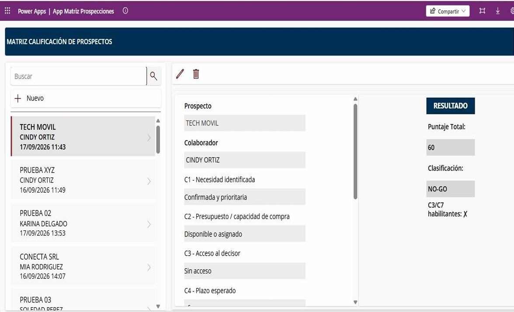
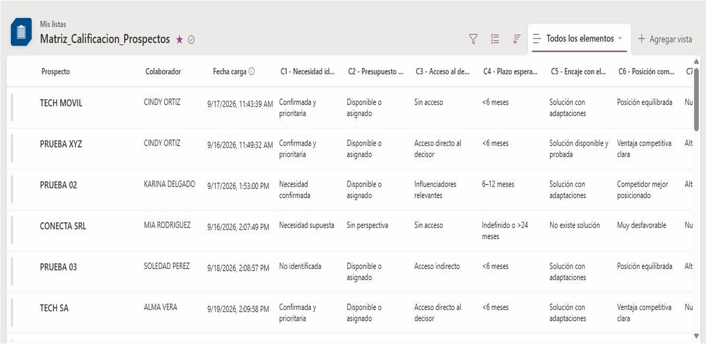
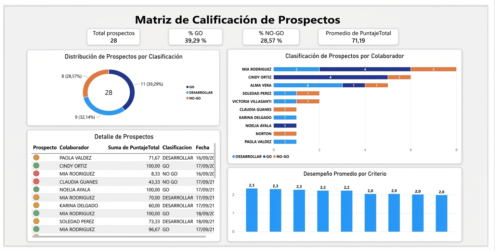

# Business Process Analysis & Prospect Evaluation Prototype

A process analysis and digital solution proposal developed during my professional internship, focused on process documentation, prospect evaluation, and information management.

## Internship Overview

- **Company:** TSV del Paraguay S.R.L.
- **Department:** Strategic Management and Communications
- **Role:** Process Analysis Intern
- **Period:** July - September 2026

## Project Overview

During my internship, I worked on two main areas:

1. **Business Process Analysis and Documentation:** Reviewing existing documentation, analyzing organizational processes, and updating process diagrams using draw.io.

2. **Digital Solution Proposal:** Exploring technological alternatives for information management and process tracking, including the development of a pilot prototype for prospect registration, evaluation, and monitoring.

## Key Activities

- Reviewed existing process documentation and work instructions.
- Analyzed and updated process diagrams using draw.io.
- Participated in review meetings and incorporated feedback.
- Investigated alternatives for process tracking and monitoring.
- Designed a prospect evaluation matrix based on nine weighted criteria (C1–C9).
- Defined scoring logic using a total score (PuntajeTotal).
- Established evaluation categories: GO, DEVELOP, and NO-GO.
- Developed a prototype integrating Microsoft Power Apps, Microsoft Lists, and Power BI.

## Tools & Technologies

- **Process Modeling:** draw.io
- **Low-Code Development:** Microsoft Power Apps
- **Data Management:** Microsoft Lists
- **Business Intelligence:** Microsoft Power BI

## Prototype Overview

The prototype demonstrates a possible workflow for prospect evaluation and information management:

1. Prospect registration.
2. Information organization and storage.
3. Evaluation based on weighted criteria.
4. Score calculation and classification.
5. Data visualization and reporting.

## Screenshots

The following screenshots illustrate the prototype and its components:

### Microsoft Power Apps

### Microsoft Lists

### Power BI Dashboard

## Project Status

The prototype and digital solution proposal were developed during the internship. At the end of my internship, the work was still at the development and research stage, with further implementation being a possibility.

The implementation status after the completion of my internship is unknown.

## Data & Confidentiality Disclaimer

All prospect records and evaluation results displayed in the prototype are fictional test data created exclusively for demonstration purposes.

This portfolio does not disclose internal company process diagrams, confidential documentation, proprietary business information, or actual prospect records.
